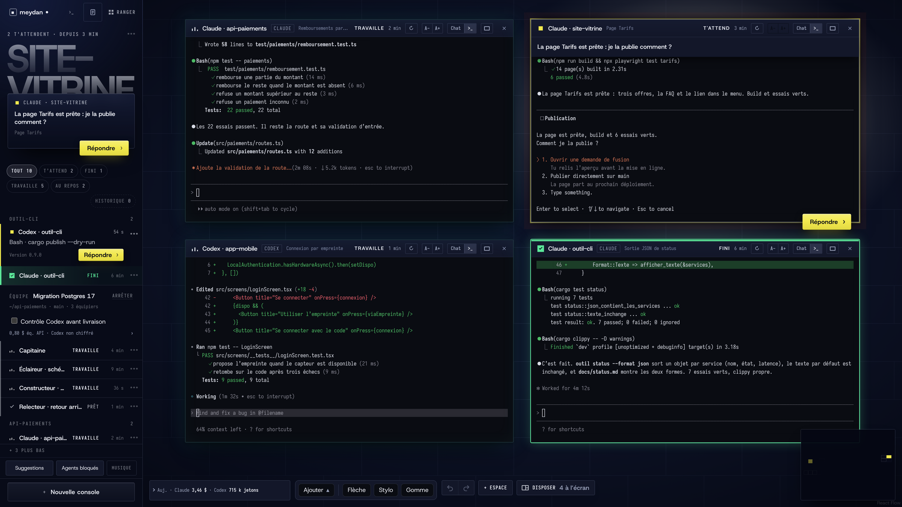
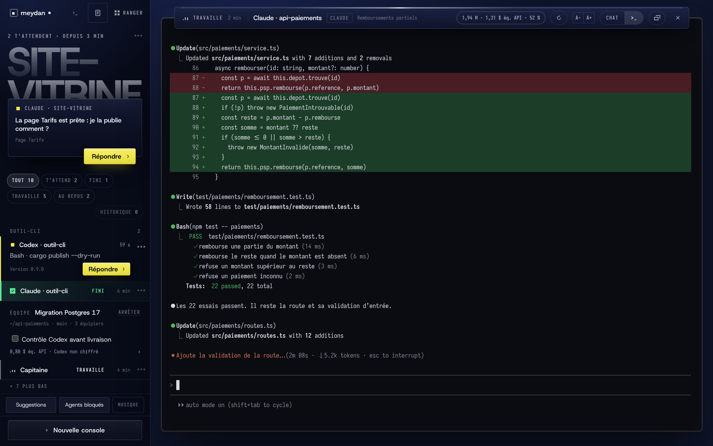
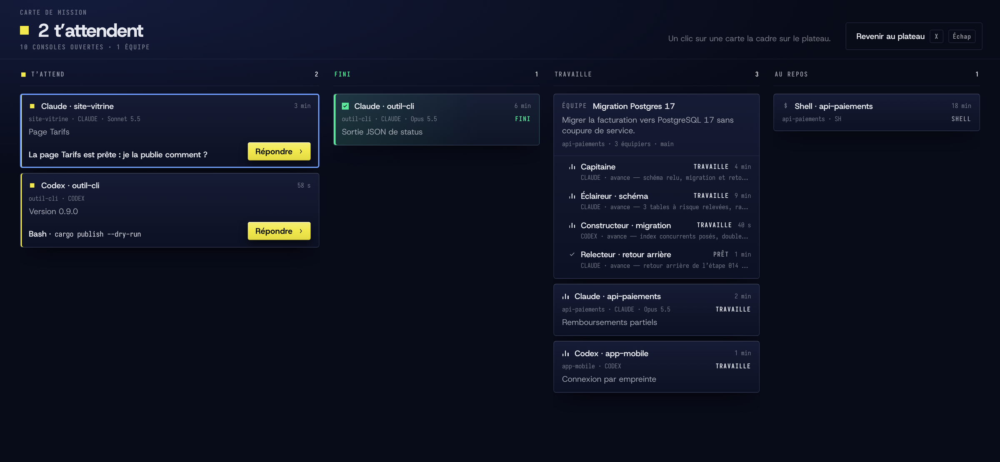
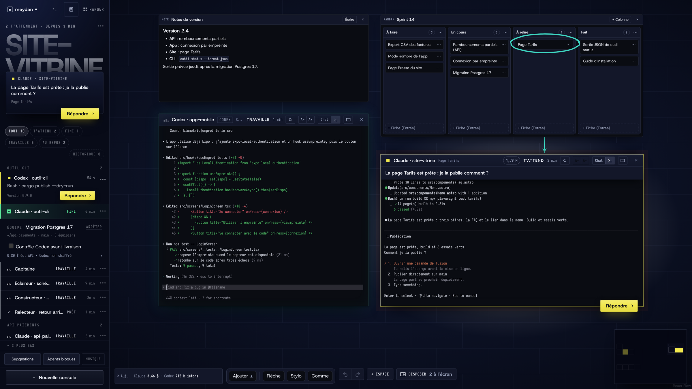
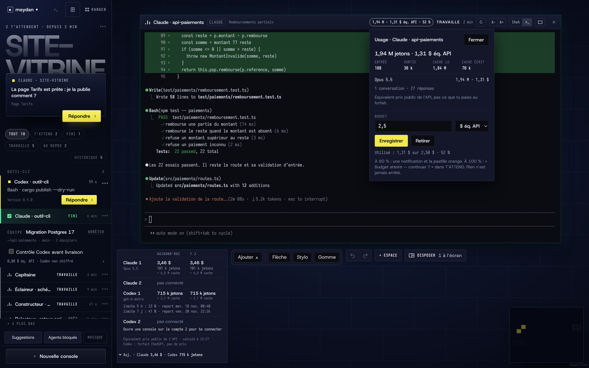
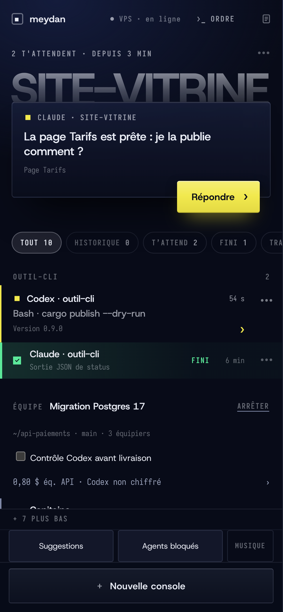
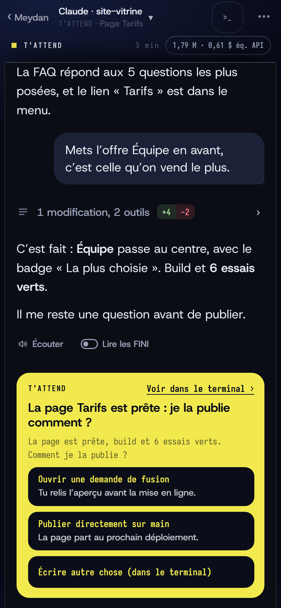
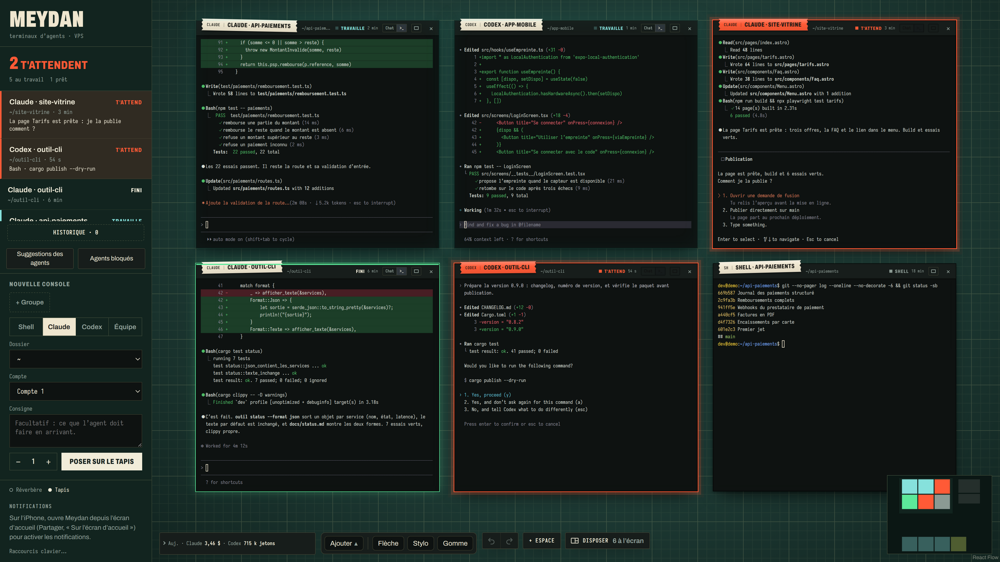

# Meydan

**All your coding agents on one board.** Meydan is a self-hosted web board that runs your Claude Code and Codex
terminals side by side on one canvas, on your server, in tmux. You can reach it from your computer or your phone.
You see at a glance which agent is working, which one is waiting for you and what it is asking. You answer from
wherever you are.

> Interface in French. *Meydan* means « the square », the place where everyone meets.



<table>
<tr>
<td width="50%"><br><sub>A console in full size, with its token usage.</sub></td>
<td width="50%"><br><sub>Mission map (<code>X</code>): what waits for you, what is done, a team at work.</sub></td>
</tr>
<tr>
<td><br><sub>Notes, kanban, ink and arrows next to the agents.</sub></td>
<td><br><sub>Usage per console and per account, optional budget.</sub></td>
</tr>
</table>

<p align="center">

&nbsp;&nbsp;

</p>
<p align="center"><sub>On the phone: every console at a glance, and any agent read as a chat — its questions become buttons.</sub></p>

<details>
<summary>Second theme, « Tapis »</summary>


</details>

## What it does

- **Live terminals on a canvas.** Each console is a real terminal (xterm.js over tmux), and you can zoom, arrange and
  group them. Sessions survive a browser refresh, a server restart and a reboot: after a reboot, agents come back on
  their own conversation (`claude --resume`, `codex resume`).
- **Status from the agents themselves.** Claude Code and Codex hooks report *Working*, *Waiting for you* (with the
  question shown on the tile) and *Ready*.
  - A counter shows how many agents are waiting for you.
  - Notifications reach your phone (Web Push).
  - Questions can be answered from buttons.
- **Phone first.**
  - Any console reads as a chat, close to the native Claude and ChatGPT apps.
  - The send bar takes screenshots, files and voice notes (local transcription).
  - The phone also offers paste, keys missing from the iPhone keyboard, long-press menus and pinch-to-zoom.
  - It installs as an app (PWA).
- **Teams.** A captain agent splits a mission and launches crew members: roles are plain Markdown files in `agents/`
  (scout, builder, reviewer…), and each member works in its own git worktree or sub-folder.
  - A mission map (key `X`) shows the whole team.
  - The captain relays messages, verifies the work and delivers only when you say go.
  - Each launch can wait for your approval.
  - *Experimental:* a team can run on a local model (Claude Code pointed at an oMLX server on your Mac, through an
    SSH tunnel).
- **Command bar and spoken orders.** Commands like « relaunch the builder », « who is waiting for me? » or « tell the
  reviewer to … » go through a small planner on your own Claude subscription (`claude -p`).
- **Project memory.** Agents propose durable facts, you validate them, and every future console of the project starts
  with them.
- **Extended canvas.** Beside the consoles you can place:
  - notes, checklists, kanban, a calendar ;
  - shapes, arrows and ink ;
  - file cards and a live preview of your local dev servers ;
  - document and diagram workshops.
- **Accounts and usage.**
  - Two Claude / Codex accounts, with one-click relaunch on the other account when a limit is hit.
  - Tokens and API-equivalent cost per console (sub-agents included).
  - Optional budgets: a notice at 80 %, a question at 100 %. Meydan never stops an agent by itself.

## Requirements

- Linux (developed on Ubuntu 24.04), **Node.js 22**, **tmux ≥ 3.4**, git, and a C/C++ toolchain for `node-pty`
  (`build-essential`, `python3`).
- [Claude Code](https://docs.anthropic.com/en/docs/claude-code) and/or [Codex CLI](https://github.com/openai/codex),
  installed and logged in for the same Unix user.
- Optional:
  - Chromium, for the console browser (`meydan nav`) and PDF export ;
  - ffmpeg plus a local speech-to-text command line (`transcribe-cli` with a Parakeet GGUF model; see
    `lib/envois.mjs` for the exact call), for voice notes ;
  - nginx and certbot, for phone access.

## Install

```bash
git clone https://github.com/orkunliman-ui/meydan.git
cd meydan
npm ci
npm run build
npm run smoke                       # optional self-test, about a minute (fake agents, its own tmux socket)
cp meydan.env.example meydan.env    # optional settings, all commented out
bash scripts/run.sh                 # or: pm2 start scripts/run.sh --name meydan --interpreter bash --cwd "$PWD"
```

Meydan only listens on `127.0.0.1:3070`. On its first start it writes `data/access.key`. Open the board through the
**key link**:

```bash
ssh -L 3070:127.0.0.1:3070 you@your-server        # from your computer
# then open  http://127.0.0.1:3070/?k=<content of data/access.key>
```

Keep that link private: it opens your shells.

Agents address you by name in their instructions (« Alex te confie une mission… »): by default your Unix user name,
or set `MEYDAN_NOM=Alex` in `meydan.env`.

## Phone access (optional)

1. Create the login:
   ```bash
   node scripts/creer-acces.mjs <username>
   ```
   It asks for a password and prints a TOTP secret for your authenticator app. Signing in always takes the password
   *and* the 6-digit code.
2. Set the public name in `meydan.env`: `MEYDAN_PUBLIC_HOST=meydan.example.com`.
3. Serve it with nginx over HTTPS.
   - `deploy/nginx-meydan.example.conf` keeps the hooks and agent API closed, rate-limits the login page and allows
     large bodies only for attachments.
   - `deploy/fail2ban-meydan.example.local` bans repeated login failures.
4. On the iPhone, *Add to Home Screen* gives you the app and notifications.

## Security — please read

Meydan hands **a shell on your server, with your user's rights**, to whoever opens it. It also runs agents that execute
commands.

- Never expose port 3070. Keep the key link to yourself, and use the public door only behind nginx with password
  and TOTP.
- Prefer a dedicated Unix user and a server that holds nothing you can't afford an agent to touch.
- Team members run restricted: Claude `--restricted` with a deny list and a Bash guard, Codex in its sandbox. They are
  **not** isolated from your account. Treat agent output as untrusted.
- Found a vulnerability? Please open a private security advisory on GitHub rather than a public issue.

## Roadmap

- **Next phase: a second board for local models.** The same canvas, dedicated to agents running on local LLMs (for
  example on a Mac with MLX), next to the cloud agents' board.
- English interface.
- Proper isolation of team members (dedicated Unix user, sandbox).

## Code map

| Path | What |
|---|---|
| `server.mjs` | engine: tmux sessions, hooks, WebSocket terminals, HTTP API, login |
| `lib/` | teams (`equipage`), memory, orders and planner, sends, chat view (`fil`), usage and budgets, canvas cards… |
| `web/src/` | React interface: canvas (`@xyflow/react`), terminals (`@xterm/xterm`), phone views |
| `bin/meydan` | the command agents use from inside a console (launch a member, report a status, propose a fact…) |
| `agents/` | team roles, one Markdown file each — edit them or add yours |
| `test/smoke.mjs` | end-to-end self-test with fake agents |

## License

[GNU AGPL-3.0](LICENSE). If you run a modified Meydan as a service for other people, you must offer them its source.
Third-party code, ideas and fonts are listed in [LICENCES-TIERCES.md](LICENCES-TIERCES.md) and
[web/src/fonts/LICENCES.md](web/src/fonts/LICENCES.md).

Built by Orkun, largely with Claude Code.

---

## En bref (français)

Meydan rassemble sur un seul plateau web toutes tes consoles d'agents de code, Claude Code et Codex. Il tourne sur ton
serveur, dans tmux.

- Chaque console montre si l'agent **travaille**, **t'attend** (avec sa question) ou est **prêt**.
- Sur téléphone, une console se lit comme une discussion, et la barre d'envoi accepte captures, fichiers et notes
  vocales.
- Tu peux lancer des **équipes** : un capitaine, des équipiers, une carte de mission, la livraison sur ton go.

Installation : voir *Install* ci-dessus.

Prochaine phase : **un second plateau pour les modèles locaux**.
